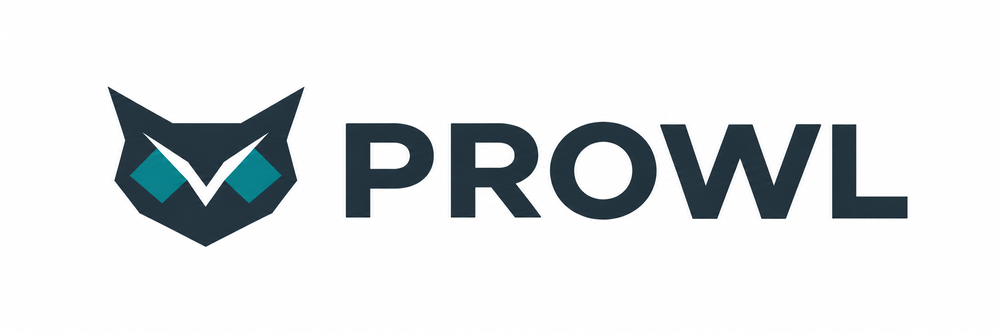

# PROWL — PROjecting Wavefunctions onto Local orbitals

[](https://github.com/ifilot/prowl/actions/workflows/ci.yml)
[](pyproject.toml)
[](LICENSE)



PROWL projects VASP PAW wavefunctions onto Slater-type atomic orbitals and
computes COHP/ICOHP, COOP/ICOOP, COBI/ICOBI, projected DOS, Mulliken/Löwdin
charges and quality diagnostics. It reads standard (`vasp_std`) and Γ-only
(`vasp_gam`) WAVECARs. The C++20 core has an FP64 CPU backend and a native CUDA
backend; the user-facing parts are a Python API and a CLI. Results can be
exported in LOBSTER's file formats.

## Install

From the repository root, with native development dependencies installed:

```bash
python3 -m venv .venv
. .venv/bin/activate
python -m pip install .
python -m pip install matplotlib
prowl --version
```

Requires Python ≥ 3.11, a C++20 compiler, CMake ≥ 3.24, Eigen 3, OpenBLAS
(including CBLAS headers), nlohmann-json and OpenMP. This installs the CPU package
and the `prowl` command. See the [installation guide](docs/getting-started/installation.md)
for native package installation and CUDA support, or the
[developer guide](docs/development.md) for CMake builds and tests.

## Run

```bash
cp docs/examples/bonding.yaml bonding.yaml        # adapt the cutoff to your system
prowl inspect  ./vasp-run                         # what is there, is it analysable?
prowl validate ./vasp-run --config bonding.yaml   # inputs and strict config check
prowl plan     ./vasp-run --config bonding.yaml   # dry run: sizes, memory, streaming blocks
prowl run      ./vasp-run --config bonding.yaml --backend cpu
prowl run      ./vasp-run --profile lobster       # LOBSTER's conventions, no config file
prowl export   ./vasp-run/bonding.h5 --format lobster --output ./lobster-like
prowl plot     ./vasp-run/bonding.h5 --kind cohp --bonds 0 --output cohp.png
```

```python
from prowl.calculation import Calculation
from prowl.config import BondingConfig

res = Calculation.open("./vasp-run").analyze(BondingConfig.from_file("bonding.yaml"), backend="auto")
print(res.quality_report())
res.save("bonding.h5")
```

VASP requirements: `LWAVE = .TRUE.`, `ISYM = -1` (or 0), a Γ-centred mesh or Γ
only, `LREAL = .FALSE.` recommended, and `NBANDS` ≥ the number of basis
functions in the cell (≥ 1.5× recommended; `prowl plan` prints the numbers).
The run directory needs `WAVECAR`, `POTCAR`, `vasprun.xml`, and a nonempty
`CONTCAR` or `POSCAR` from the same calculation. SOC and noncollinear
wavefunctions are currently unsupported. Read the
[quality guide](docs/science/quality.md) before interpreting results.

## Tests with real VASP data

POTCARs, WAVECARs and LOBSTER outputs are never committed. The real-data tests
are skipped unless the fixtures exist; generate them from the recipes in
`tests/private_vasp_manifest/recipes`:

```bash
python tools/run_vasp_fixture.py c_diamond_k7 --runs ./runs \
  --vasp-bin /path/to/vasp/bin --potcar-dir /path/to/paw-datasets --np 8
PROWL_TEST_RUNS=./runs pytest
```

## Licence

Code: GPL-3.0-or-later (`LICENSE`). PROWL's own basis data (`paw-pbe-sto-1` and
the generated polarization functions): CC BY-SA 4.0
(`data/basis/paw-pbe-sto-1/LICENSE.md`). The Koga basis data are redistributed
from the CC0 AtomicOrbitals project; the upstream tables are vendored verbatim
in `data/basis/koga/upstream/`. `tools/basisfit/data/` contains a pymatgen basis
table (MIT, `LICENSE.pymatgen`).
